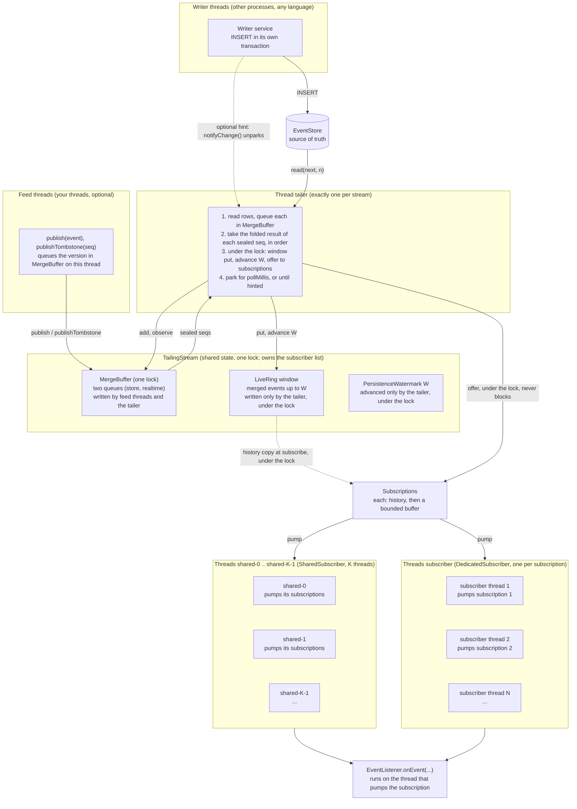

# Subscribing to an Event Stream Without Missing or Repeating an Event

*A learning project: the `live-history-stream` library (`com.example.livestream`), one sequence number and one watermark, from a writer's insert to a subscriber's callback.*

## Table of contents

- [The problem](#the-problem)
- [The idea: one sequence number, one watermark](#the-idea-one-sequence-number-one-watermark)
- [Architecture](#architecture)
- [Merge on the fly: realtime feed and duplicates](#merge-on-the-fly-realtime-feed-and-duplicates)
- [Subscribers and overflow](#subscribers-and-overflow)
- [Threading model](#threading-model)
- [Why it is correct](#why-it-is-correct)
- [Progress guarantees (honest version)](#progress-guarantees-honest-version)
- [Slow subscribers](#slow-subscribers)
- [The Tailer](#the-tailer)
- [Gaps and visibility order](#gaps-and-visibility-order)
- [Usage](#usage)
- [Variations](#variations)
- [Tuning](#tuning)
- [Layout](#layout)
- [Related work, and where this design differs](#related-work-and-where-this-design-differs)
- [Known limitations (important for a production design)](#known-limitations-important-for-a-production-design)
- [Walkthrough: the seam, step by step (for the article)](#walkthrough-the-seam-step-by-step-for-the-article)
- [Exercises / where to go next](#exercises--where-to-go-next)
- [Under the hood: the cost of `AtomicReferenceArray` (and the alternatives)](#under-the-hood-the-cost-of-atomicreferencearray-and-the-alternatives)
- [Partitions with separate data sources (no global order)](#partitions-with-separate-data-sources-no-global-order)
- [What the tests check](#what-the-tests-check)
- [Benchmark](#benchmark)
- [Demo](#demo)

## The problem

Writer services insert events into a database (or append them to a log) on their own schedule. A new subscriber
must see **(a) history from some point, then (b) everything live**, and must never miss or repeat an event
at the seam between the two. Many subscribers. The merger takes one short lock per merged event (see **Threading model**).

The classic bugs:

| Naive approach | Failure |
|---|---|
| read DB, then subscribe to live | events published in between are **lost** |
| subscribe to live, then read DB | events appear in both -> **duplicates / reordering** |
| read DB, subscribe, "dedupe by timestamp" | clocks tie / differ across writers -> still wrong |
| lock around "snapshot + subscribe" | blocks all writers while a subscriber loads history |

This library answers it with a single process-local component, the **Tailer**, which follows the store, and a small
in-memory window of the newest merged events. The store is the source of truth for committed rows. A realtime event can
be delivered before its row is in the store (see **Merge on the fly**), so the window can hold an event the store does
not have yet; it is not durable until the row arrives.

## The idea: one sequence number, one watermark

1. **Sequence number (one per stream).** Every event has a gap-free `seq` assigned by the store when a writer inserts
   it (auto-increment, outbox position, log offset). `seq` is the total order and the only thing a subscriber needs to
   remember: its cursor `next`. "One" means one per stream; with partitions (see **Partitions with separate data
   sources (no global order)**) each partition has its own. Why a sequence at all is explained in **Why a sequence
   number, and why a total order inside one stream**.
2. **Visibility watermark `W`.** Highest seq such that all events `<= W` are visible in the store, contiguously (or
   declared dead, see **Gaps and visibility order**). It is observed by the Tailer, never produced by us.
3. **Write before advance.** The Tailer writes an event into its ring slot first and advances `W` over it second.

Consequences (the invariants everything rests on):

* **I1** every `seq <= W` is merged, written to the window, and delivered to the live subscribers, or declared dead;
* **I2** a subscriber that registers at `W` gets the window from its `fromSeq` up to `W` as history, and the merger offers
  every later event to it, all under one lock, so nothing is missed and nothing is delivered twice;
* **I3** a subscriber that falls behind its own buffer is cancelled, and only it. It can re-subscribe from `nextSeq()` while
  that seq is still in the window;
* every `seq > W` is not visible to anyone yet, so there is nothing to deliver and waiting is correct.

Subscribers never read the store. The window is the only history they get, and the store is read only by the Tailer.

Illustrated with: `PersistenceWatermark.get()`, `LiveRing.read(long)`

```
 seq:   1 .......................... W      (not visible yet)
        |<-- always readable in the store -->|
                       |<-- window (capacity N): the newest merged events up to W -->|
                         (the handoff is safe because the window copy and the join happen under the stream lock)
```

### What a volatile read is, and how it detects "I fell behind"

A volatile read is an ordinary read of a shared variable with a Java memory-model guarantee attached: the reader sees the
latest value that another thread wrote to that variable, and it also sees everything that thread wrote before that
value. There is no lock and no waiting, and on x86 the instruction is a normal load. `AtomicReferenceArray.get` is a
volatile read of one array slot, and `AtomicReferenceArray.set` is the matching volatile write. That pair is what makes
publishing an event safe: the Tailer builds an immutable `Event`, writes it into the slot with one volatile write, and a
reader that sees the reference in the slot also sees the fully built event, never a half-initialised one.

Detecting that a seq has left the window needs exactly one such read, because the slot holds the event together with its
own `seq`. A new subscriber asks the window for each seq it wants as history. `LiveRing.read(long)` does this:

```java
Event e = slots.get((int) (seq & mask));   // the one volatile read
if (e == null || e.seq() < seq) return null;           // slot is older: not written yet
return e.seq() == seq ? e : OVERRUN;                   // equal: here it is; newer: the slot was recycled
```

The slot for `seq` is also the slot for `seq + capacity`, `seq + 2 * capacity` and so on. If the Tailer has moved a full
lap ahead, the slot now holds a larger seq than the one the reader wants, and that one comparison tells the reader it is
too old for the window. No counter, no lock and no second read are needed. The subscribe call is rejected with
`IllegalArgumentException`. Subscribers do not read the store, so the window is the only history they get.

### Why a sequence number, and why a total order inside one stream

A subscriber must be able to say "I have everything up to here, continue after it". That position has to mean the same
thing in the window and in the store. What could the position be?

* **A timestamp.** Two events can have the same millisecond, and two writers can have different clocks, so a later event
  may carry an earlier time. Resuming "from time T" can then skip an event or deliver one twice.
* **An id with holes** (increasing, but some values are skipped, for example 1, 2, 4). When the subscriber sees 4 after 2,
  it cannot tell whether event 3 is missing or was never used.
* **The DB row id for the store and the array index for the ring.** The same event then has two different numbers, so the
  subscriber cannot continue with the same cursor when it switches between the two.
* **No position, only a set of the ids already seen.** The state grows with every event and has to be stored and compared.

A **dense** `seq` (1, 2, 3, ... with no value missing, assigned in the order of the events) avoids all of these:

* **One number in both places.** `window[seq & mask]` and `WHERE seq >= ?` use the same value, so the Tailer and the
  window address an event the same way.
* **Loss and repetition are detectable.** Deliver only if `seq == next`, then `next++`. Anything else is a gap or a
  duplicate. The Tailer never produces one, and the tests check it (`CheckingListener` reports any break in order).
* **The subscriber's whole state is one number.** Resume with `lastSeq + 1` (SSE `Last-Event-ID`).
* **The watermark is one number.** "Every event `<= W` is visible" is a statement about a prefix, and a prefix only exists
  if the events are totally ordered. Without it, "what is visible" would be a set, and "read the window or the store?" could
  not be a single comparison.
* **Overrun detection is one comparison.** The slot holds its own `seq`: older means not written yet, equal means here,
  newer means overwritten. A ring without the seq in the slot would need a separate lap counter or a lock.

So the total order is not wanted for its own sake. It is what turns "history, then live, with no gap and no duplicate"
into a comparison of integers (`next` against `W` and against the slot's `seq`).

**Why it only needs to hold inside one stream.** Nothing above requires that events of different streams are ordered
relative to each other. A subscriber only has to know, per stream, where it is. That is why the order can be made
per-partition (see **Partitions with separate data sources (no global order)**): the guarantees are identical inside
each partition, the cursor becomes a vector, and the one price is that no one can ask "which of these two events from
different partitions came first".

**What it costs.** The order has to be created somewhere. Here the store creates it, and concurrent transactions can make
ids visible out of order, so the problem becomes gap handling (see **Gaps and visibility order**). One sequence per stream
is also the scalability ceiling of that stream.

## Architecture



The diagram shows one stream. Each box is a thread (or a group of threads) or shared state, and the arrows are the only
interactions between them. The Tailer is the only thread that reads the store and the only thread that writes the window
and `W`. It writes them under one lock, `TailingStream.lock`, which also covers a new subscriber's history copy and join.

| Thread | How many | Started by | Writes | Reads |
|---|---|---|---|---|
| Writer | any number, in other processes | your application | the store | nothing from this library (optional `notifyChange()` call) |
| Feed | any number, your threads | your application | `MergeBuffer` (`publish`, `publishTombstone`) | nothing |
| Tailer | exactly 1 per stream | `TailingStream` constructor | `MergeBuffer`, window, `W`, subscriber buffers (under the lock) | the store, `MergeBuffer` |
| Shard | K per `SharedSubscriber` | `SharedSubscriber` constructor | the listener's own state | its subscriptions' buffers (no store, no window) |
| Subscriber | 1 per subscription | `DedicatedSubscriber.subscribe` | the listener's own state | its own buffer (no store, no window) |

Consequences:

* **One reader for the store.** Only the Tailer reads the store. Merged events are fanned out to every subscriber
  buffer, so adding subscribers adds consumer work, not store reads.
* **Subscribers never run on the Tailer.** The Tailer only offers an event into each buffer. A slow listener delays only
  its own shard or its own thread, never the Tailer or the writers.
* **Each subscription has one consumer thread.** Its cursor is touched by that thread only, so it needs no lock.
* **A new subscriber joins without a gap.** Its history is copied from the window and the subscriber is added to the list
  under the same lock that the Tailer holds while it merges an event, so the history and the live events meet exactly once.

A partitioned stream (see **Partitions with separate data sources**) repeats this block once per partition: each
partition has its own store, Tailer, window, watermark and subscriber. The diagram above is therefore the unit to
multiply, and the thread count grows with the number of partitions.

What a subscriber's buffer does when the merger offers an event:

| Buffer state | What happens |
|---|---|
| room for the event | the event is queued; the merger moves on |
| full | the subscriber is cancelled and its listener gets `onError` ("subscriber too slow"); the merger moves on |

The merger never waits for a buffer. That is the whole back-pressure story: a slow subscriber loses its place, not the
other subscribers' events (see **Subscribers and overflow**).

## Merge on the fly: realtime feed and duplicates

Both inputs are at-least-once: the store and the realtime feed may each repeat a seq, and a realtime version may
describe a seq the store has not written yet (an open candle, for example). The library never writes to the store.
Every seq is merged before it is delivered, and delivered once.

```java
TailingStream stream = new TailingStream(store, 1024, 256, 1, 60_000, gapListener, MergePolicies.PREFER_STORE);
stream.publish(candleFromFeed);        // realtime version; may repeat, may come before its store row
stream.publishTombstone(seq);          // optional: "no more realtime versions at or below seq" (end of day)
```

**Sealing.** A seq is held until it is *sealed*:

* a higher seq has been seen from either input (store or feed), or
* a tombstone at or above it has arrived.

Until then the versions wait in a buffer (`MergeBuffer`), in one queue per input: store rows and realtime versions, each in
seq order. When the seq is sealed, the Tailer takes its versions, folds them into one event with the merge policy
(realtime versions first, then store), writes it to the window and the watermark advances.
A sealed seq with no version in either input is a hole **only if a higher seq is already known** (in the store or the
feed). Otherwise nothing is written above it yet, so the Tailer waits instead of declaring it dead. The gap timeout
applies to holes as before.

**Worked example.** One candle, seq 1, arrives as feed 105, feed 104, store 103. Seq 2 (from the store) seals it. The
policy folds the three versions when seq 1 is taken, realtime first:

| Policy | Delivered for seq 1 |
|---|---|
| `KEEP_FIRST` | `feed 105` (the first version in fold order) |
| `KEEP_LAST` | `store 103` (the last version in fold order) |
| `PREFER_STORE` | `store 103` (the last store version) |

This is `RealtimeMergeTest.theSameCandleUnderEachBuiltInPolicy`.

**The merge policy** is a `BinaryOperator<Version>`, the same shape as the remapping function of `Map.merge`. It gets
the result so far and the next arriving version of the seq, and returns the new result. Each `Version` carries the event
and its origin (`STORE` or `REALTIME`). The built-in policies are constants of `MergePolicies`:

| Policy | Delivers |
|---|---|
| `MergePolicies.PREFER_STORE` (default) | the last store version; if there is none, the last realtime version |
| `MergePolicies.KEEP_FIRST` | the first version in fold order (the first realtime version, if there is one) |
| `MergePolicies.KEEP_LAST` | the last version in fold order (the last store version, if there is one) |
| a custom lambda | the fold you write, for example open and high from the store, close from the feed |

The result must keep the seq; the Tailer throws `IllegalStateException` otherwise.

The realtime feed must publish in non-decreasing seq order (repeats are fine). `publish` throws `IllegalArgumentException` for a
seq lower than an earlier realtime seq, because the realtime queue depends on that order. The store is in seq order by
its contract, and the Tailer checks it.

Repeats are not dropped before the fold: a repeated version is folded again. The built-ins give the same result for a
repeat; a policy that counts or appends would see it twice. A policy runs on the Tailer thread, under the `MergeBuffer`
lock, when the seq is taken, so it must be quick and must not call back into the stream.

**Trade-offs of sealing:**

* A stream with no feed waits for the next store row before it delivers the last one. On a quiet stream, use
  `publishTombstone` to release it.
* A tombstone promises that the store already holds every row at or below its seq. A row that arrives later, below a
  higher seq that is already known, is a hole and is declared dead by the gap timeout. A row above the highest known
  seq is simply waited for, never declared dead.
* A realtime version for an already delivered seq is ignored.
* Realtime-only seqs (not yet in the store) are delivered once sealed. Until the store has them, they are not durable.

**Subscribers and the window.** Subscribers never read the store. They read the merged output, which is the window of
recent merged events (see **Subscribers and overflow** below).

## Subscribers and overflow

Implemented. Each subscription has a bounded buffer of merged events. Its listener runs on the consumer thread of the
`Subscriber` it was subscribed through. There are two implementations of `Subscriber`, and the caller chooses one. Both extend the package-private
`AbstractSubscriber`, which holds the stream and does the common work of `subscribe`: register the subscription with the
stream, then give it to a thread through `start`. Each subclass decides only the thread and what `close()` does:

| Class | Threads | Use it for |
|---|---|---|
| `SharedSubscriber` | K shard threads (`shared-0`, ...), shared by all its subscriptions, assigned round-robin | the default: many subscribers, cheap. A listener that blocks delays the others on its shard |
| `DedicatedSubscriber` | one thread per subscription (`subscriber`) | a slow or untrusted listener that must not delay anyone else. Costs one thread each |

Both implement the same `subscribe(fromSeq, listener, capacity)`, so switching is a change of one line. Both call
`TailingStream.register` internally, which returns a package-private `SubscriptionImpl`; users only ever see the `Subscription` interface.

`DedicatedSubscriber` keeps the subscriptions it started in a set, so `close()` can cancel them. A subscription leaves
the set when its thread finishes, so a long-running process does not keep finished subscriptions. `SharedSubscriber`
drops a finished subscription from its shard in the same way.

A stream with no realtime feed should declare its store complete with `publishTombstone(Long.MAX_VALUE)` once, so each
row is delivered as soon as the Tailer reads it, without waiting for a higher row. Holes below the highest row are still
declared dead after the gap timeout; rows above it are waited for. `TestStreams.storeOnly` in the tests does this.

The merger never waits for a subscriber. For each merged event it offers the event to every subscription's buffer:

* If the buffer has room, the event is queued.
* If the buffer is full, the subscriber is **cancelled** and its listener gets `onError`
  (`IllegalStateException`, "subscriber too slow"). No other subscriber is affected. The subscriber may re-subscribe from `nextSeq()`, its last delivered seq + 1, as long as that seq is still
  in the shared window of merged events. A seq older than the window is rejected with `IllegalArgumentException` at
  subscribe time.

A new subscriber first receives the window events from its `fromSeq` up to the watermark, copied under the same lock
the merger uses, and then the live events. This closes the seam: nothing is missed and nothing is delivered twice.

Alternatives considered: blocking the merger until the subscriber catches up (one slow listener stalls the whole
stream, rejected); a store fallback for subscribers that fall behind (it returns raw rows, not merged ones, rejected);
a dedicated thread for every subscriber (simplest isolation, but costs a thread each; this is `DedicatedSubscriber`, offered for the subscribers that need it).

### Restart

The window lives in memory, so a new process starts with an empty one. The constructor fills it before the Tailer starts:
it reads the last `ringCapacity` rows below `store.lastSeq()` from the store and puts them in the window. Subscribers
then get the same recent history after a restart as before it, and they still never read the store.

* Cost at start-up: one read of at most `ringCapacity` rows (a few thousand in typical use). The constructor blocks until
  it is done.
* The store must be contiguous up to `lastSeq()`, which the `EventStore` contract already requires.
* A subscriber that asks for an older seq is rejected with `IllegalArgumentException`, as before. Its consumer must treat
  that as "your position is older than the window" and cannot recover the history from this stream alone.
* Realtime versions that were not yet in the store before the crash are not recovered. Only rows in the store are.

## Threading model

The library starts three kinds of thread. None is a pool: each is a fixed, named, long-running thread, created by a
constructor or a subscribe call and never resized.

| Thread | Name | Count | Started by | Runs |
|---|---|---|---|---|
| Tailer | `tailer` | 1 per `TailingStream` (1 per partition in a `PartitionedStream`) | `TailingStream` constructor | the Tailer loop: store read, merge of sealed seqs, window write, watermark advance, gap timeout, `GapListener` |
| Shard | `shared-0`, `shared-1`, ... | K per `SharedSubscriber` (`shardThreads`) | `SharedSubscriber` constructor | pumps the shared subscriptions it owns, and calls their `EventListener` methods |
| Subscriber | `subscriber` | 1 per subscription | `DedicatedSubscriber.subscribe` | pumps one subscription and calls its `EventListener` methods; nobody else shares it |

Writers are not part of the library, so they are not listed. Any number of writer threads, in any process, insert into
the store.

Rules that keep the design lock-free on the read path:

* **One writer per shared structure.** Only the Tailer merges and writes the window (`LiveRing`) and the watermark. Readers
  only read.
* **One lock for the seam.** `TailingStream.lock` is held by the Tailer while it writes the window, advances the watermark
  and offers the event to every subscriber, and by a subscriber's registration while it reads the watermark, copies the
  history and joins the list. Without it a subscriber could miss an event between its history copy and its join. The
  lock is never held while a listener runs: `offer` only inserts into a bounded buffer.
* **Each subscription has one owner.** `SharedSubscriber.subscribe` puts a new subscription in a shard's lock-free inbox
  (round-robin). The shard drains the inbox into its own list, and only that shard thread pumps the subscription, so
  the cursor needs no lock. Cancelling sets a volatile flag, and the owning shard removes the subscription.
* **Shared subscribers are not threads.** Ten thousand subscriptions cost ten thousand small objects, spread over K shard
  threads. A dedicated subscriber costs one thread, and only on request.
* **A shard polls, a dedicated subscriber blocks.** A shard serves many subscriptions, so it cannot block on one buffer. When a
  round delivers nothing it pauses (spin, then yield, then park up to 1 ms) and resets as soon as a round delivers
  something: low latency while busy, little CPU when idle. A dedicated subscriber owns one subscription, so it blocks on
  that buffer (up to 50 ms, to notice cancellation) and wakes the moment an event arrives.
* **A shard never waits for the Tailer, and the Tailer never waits for a shard or a listener.** The merger only offers
  events into bounded buffers and cancels a subscriber whose buffer is full.

What runs where, for one stream:

* `EventStore.read` and `nextVisibleSeq` are called only by the **Tailer** thread. Subscribers never read the store,
  so the store does not need to be safe for concurrent reads from subscriber threads.
* `GapListener.onGapSkipped` runs on the **Tailer** thread, so it must return quickly. It delays the watermark while it runs.
  The merge policy runs on the thread that adds a version: the Tailer for store rows, the feed's thread for realtime versions.
* `publish(Event)` runs on the **caller's** thread (the realtime feed). It only queues the version in the buffer; the merge policy does not run there.
* `EventListener.onEvent` runs on a **shard** thread, or on the **subscriber** thread for a dedicated subscription. A
  listener that blocks stalls every subscription on its shard (see **Slow subscribers**). A dedicated subscriber is not
  affected by other listeners. The library does not detect a blocked listener.
* `notifyChange()` runs on the **caller's** thread. It only unparks the Tailer.

Lifecycle:

* All threads are daemon threads, so they do not keep the JVM alive.
* `TailingStream.close()` stops the Tailer and waits up to 2 seconds for it to finish. It cancels every subscription, and
  a dedicated subscriber thread ends with its subscription.
* `SharedSubscriber.close()` tells each shard to stop, but does not wait for the shard threads to end.
* Several subscribers may share one stream, each with its own threads. The demo does this to keep one slow
  consumer on its own thread.

Why not a thread pool: a pool hands out short tasks. Here each shard is a long-running loop that owns state (its
subscriptions), so a pool would add queueing and task objects without a gain. A fixed set of named threads also makes
the thread dump easy to read: `tailer`, `shared-*` and `subscriber`.

## Why it is correct

* **Order / no duplicates:** the cursor moves forward by exactly 1 per delivered event, and an event is delivered
  only if its `seq == next`. The merger delivers each seq once: a seq is merged only after it is sealed, and a later
  version of a delivered seq is ignored (`publish` drops seqs at or below `W`).
* **No gaps:** the Tailer delivers seq `n` only after `n-1`. It stops at a hole, a sealed seq with no version, until the
  hole is filled or declared dead by the gap timeout.
* **The seam:** the window write, the advance of `W` and the offer to each subscriber happen under one lock. A new
  subscriber's history copy and its join happen under the same lock. So a subscriber sees each seq once, either in its
  history or live.
* **Dead ranges are registered first:** a range the Tailer gives up on is recorded in `SkippedSeqs` before `W` moves past
  it, so no subscriber can see `W` beyond a hole that it has not yet been told about.
* **Immutable events:** an `Event` is a record, so a listener on another thread cannot see a half-built event.
* **No durability gap for stored rows:** the window only holds merged events, and every stored row goes through the
  same merge. A crash loses the window, and the constructor reloads it from the store (see **Restart**). Realtime-only
  events that were never written to the store are lost in a crash, as stated under **Merge on the fly**.

## Progress guarantees (honest version)

| Part | Guarantee |
|---|---|
| window write | one volatile write by the single Tailer thread, under the stream lock |
| window read | wait-free (one volatile read), used only when a subscriber registers |
| merge and window write | one thread (the Tailer), under the stream lock held only for the window write, the advance of `W` and the offers |
| subscribe | takes the stream lock briefly to copy history and join; this is the only lock a subscriber touches |
| subscriber buffer | bounded `ArrayBlockingQueue`; the merger never blocks on it, a full buffer cancels the subscriber |
| cancel | a volatile flag, read by the consumer thread |
| reads from the store | once per node by the Tailer, not once per subscriber |

Caveats you should know about:

* A hole in the store (a transaction still in flight, or one that rolled back) stops the Tailer, so **every** subscriber
  waits at that seq until the writer commits or `gapTimeoutMillis` expires (see **Gaps and visibility order**).
* A slow store only delays `W`. The feed's `publish` only inserts into the merge buffer and never waits for subscribers.
* Notifications are hints, not data. With none, the delay of a new event is up to `pollMillis`.
* The Tailer catches exceptions from the store, logs them as warnings with the cause and retries after the poll interval
  (see **What the Tailer logs**). A store that keeps failing stalls the stream, so alert on those warnings and when
  `visibleSeq()` stops advancing.

## Slow subscribers

A slow subscriber never slows the Tailer or the writers: the merger offers each event to a bounded buffer and never waits.
When the buffer is full the subscriber is cancelled and its listener gets `onError` ("subscriber too slow"). No other
subscriber is affected, and subscribers never read the store to catch up. The subscriber may re-subscribe from
`nextSeq()`, which works while that seq is still in the window (see **Subscribers and overflow**). Metric:
`Subscription.isCancelled()`.

Listeners must not block the shard thread. For real websockets: `onEvent` -> offer to a bounded per-connection
queue; if it is full, `cancel()` the subscription (client can reconnect with `subscribe(lastSeenSeq + 1, ...)`).
Put untrusted consumers on their own thread (`DedicatedSubscriber`), or on their own `SharedSubscriber`. A cancelled
subscription stops mid-batch, even while reading history, and no longer fires `onCaughtUp()`.

## The Tailer

Writers are other services. They insert into the store and never call into our process. What we have is:

* the **store**: the source of truth, from which we can ask "what is the last contiguous seq?" and "give me events from seq X";
* optionally **notifications** (Postgres `LISTEN/NOTIFY`, CDC, a message on a topic) that say "something changed".

Notifications are **hints, not data**: they can be lost, duplicated, coalesced or reordered. Correctness must come from
reading the store.

Sketch of `Tailer.run()`:

```java
// single thread per node; the only writer of the window and of W
long next = store.lastSeq() + 1;                 // or a persisted checkpoint
long readNext = next;
for (;;) {
    long before = readNext;
    try (Stream<Event> rows = store.read(readNext, 512)) {  // contiguous, starting exactly at readNext
        for (Iterator<Event> it = rows.iterator(); it.hasNext(); readNext++) {
            buffer.add(new Version(it.next(), STORE));      // each row goes straight into the buffer
        }
    }
    if (readNext == before) { waitForHintOrTimeout(); continue; }   // hint = LISTEN/NOTIFY, CDC message, ...
    while (buffer.sealed(next)) {                // a higher seq is known, or a tombstone
        Event merged = buffer.take(next).event();   // the seq's versions, folded
        lock.lock(); window.put(merged); watermark.advance(next); offerToSubscribers(merged); lock.unlock();
        next++;
    }
}
```

* Only the Tailer reads the store, so reads happen **once per node**, not once per subscriber. The window and the buffers
  fan the data out.
* The poll timeout is a safety net: if a notification is lost, the stream is delayed by one poll interval, not broken.
  With no notifications at all it degrades into plain polling.
* Many nodes can each run their own Tailer over the same store; seqs come from the store, so a subscriber can
  reconnect to any node with `lastSeq + 1`.

### Writing is decoupled from reading

Writers and readers never touch each other's data path:

* **Writers are independent.** A writer service inserts into the store and nothing else. It does not write into the
  window, does not wait for subscribers, and does not know the stream exists. A notification is an optional hint.
* **Only the `Tailer` writes the window.** It is the single writer of `LiveRing` and of `PersistenceWatermark`, and it
  advances the watermark only after the window slot is written, under the stream lock.
* **Subscribers never write shared state.** A subscriber reads its own buffer and keeps its cursor privately. It never
  reads the store.

So the number of writers can change without any reader or window-slot coordination, and a slow or crashed writer never
blocks other writers: they keep inserting. Subscribers do feel it, though. The Tailer stops at the writer's hole, so
nothing after it is delivered to anyone until the writer commits or `gapTimeoutMillis` expires. A transaction that
commits after that timeout is missed (see the `Tailer` javadoc).

## Gaps and visibility order

This is where the real engineering lives.

If the store assigns ids to concurrent transactions, **id 11 can become visible before id 10 commits**. If the Tailer
reads 11 first and moves on, event 10 is lost to every subscriber when it later appears. So:

* `store.read(from)` must return events **contiguous from exactly `from`**, and the Tailer must stop at the first hole.
* `W` is the highest **contiguous** visible seq, never `MAX(id)`.
* A hole may be (a) a transaction still in flight, (b) a rolled-back transaction (the id will never appear),
  or (c) a deleted row. The Tailer cannot tell (a) from (b) by looking.

Ways to deal with it, from most to least robust:

| Approach | Idea | Cost |
|---|---|---|
| **Commit-ordered position** | Use a position that is monotonic in commit order (a single-writer outbox table, or the log offset of a Kafka/WAL topic) | needs a single ordered point on the write path |
| **Single sequencer service** | Writers ask one service for the next seq, or it writes on their behalf | a new component and a bottleneck |
| **Gap timeout** | Wait for a hole to fill; after `T` (longer than the maximum transaction time), declare it dead and skip it | a late commit after `T` is **silently missed**; `T` is a guess |
| **Per-writer sequences, vector cursor** | Each writer has its own gap-free sequence; the cursor is `{writer -> next}` | the cursor grows with the number of writers; no global order |

State clearly in the article which one you picked: it decides the delivery guarantee, and "gap-free" is only as strong as this choice.

### What the Tailer logs

The library logs through the SLF4J facade (`slf4j-api` is its only runtime dependency) and leaves the backend to the
application. Add Logback, Log4j 2 or any other SLF4J binding to see the messages, for example Logback's default console
output. Without a binding SLF4J discards them. The tests use Logback with a console appender (`src/test/resources/logback-test.xml`).
The logger name is `com.example.livestream.Tailer`.

| Level | Message | What it means |
|---|---|---|
| INFO | `Tailer started at seq 3 (read batch 16, poll 1 ms, gap timeout 150 ms)` and `Tailer stopped, next seq to read was N` | lifecycle, with the settings in effect |
| DEBUG | `Hole at seq 3: seq 4 is already visible, waiting up to 150 ms for it to fill` | a hole was noticed, logged once per hole; normal with concurrent writers |
| DEBUG | `Hole at seq 3 filled after 12 ms: a version arrived in time` | the hole was only a transaction in flight; nothing was lost |
| WARN | `Gap timeout: seqs 3..3 declared dead after 150 ms (rolled back, or not committed in time; a late commit would be missed)` | the Tailer gave up and skipped the range; the `GapListener` is called as well |
| WARN | `Store read failed at seq 1, retrying in 1 ms` with the exception attached | a failing store; the Tailer retries after every poll interval |

The WARN about a gap is the line to alert on. A run of dead ids is one warning for the whole range, because it costs one
timeout. A DEBUG hole message that is not followed by either a "filled" message or the WARN means the Tailer is still
waiting within `gapTimeoutMillis`. Keep DEBUG off in production if writers are busy, since holes are frequent then.

### How the gap timeout works, and what it assumes

The `Tailer` starts a timer when it first sees a hole at `next` while a higher seq is already known (in the store or the
feed). When the timer reaches `gapTimeoutMillis` it declares the **whole range** `next .. lowestKnown-1` dead in one step, registers it in
`SkippedSeqs`, reports it to the `GapListener`, and only then moves `W` past it.

Skipping the whole range is safe **if ids are assigned in time order** (a DB sequence with `CACHE 1`, an outbox
table, a log offset). Every id below the lowest visible one was taken before that one committed, so when the timer
fires each of them has been open for at least `gapTimeoutMillis`. The set of visible ids only grows, so the lowest
visible id above the hole can only get smaller while the timer runs, which keeps that argument true. A transaction
shorter than the timeout therefore always makes it, even in the middle of a range (`aTransactionShorterThanTheTimeoutSurvivesInsideAHoleRange`),
and a run of dead ids costs one timeout, not one per id (`severalHolesAreSkippedOneAfterTheOther`).

It is **not** safe if ids are handed out of time order, for example Postgres sequences with `CACHE` greater than 1
used from several sessions, or several independent id generators. Then an id inside the range can belong to a
transaction that started after the timer did, and it is silently missed even though it was shorter than the timeout.
With such a store use a commit-ordered position from the table above instead of a gap timeout.

## Usage

Calls: `new TailingStream(...)`, `TailingStream.publish`, `TailingStream.notifyChange()`, `new SharedSubscriber(...)`,
`new DedicatedSubscriber(...)`, `Subscriber.subscribe(fromSeq, listener[, capacity])`, `Subscriber.LATEST`:

```java
EventStore store = new MyJdbcEventStore(...);            // implement read, lastSeq, firstSeqAtOrAfter (nextVisibleSeq has a default)
GapListener gaps = (from, to) -> log.warn("skipped dead ids {}..{}", from, to);

try (TailingStream stream = new TailingStream(store, 1 << 16, 512, 5, 30_000, gaps);
     SharedSubscriber shared = new SharedSubscriber(stream, 4, 256);     // 4 shard threads, shared
     DedicatedSubscriber dedicated = new DedicatedSubscriber(stream)) {  // a thread per subscription

    // writers insert into the store on their own; a writer (or a CDC hook) may add a latency hint:
    stream.notifyChange();

    // history from seq 1000, then live
    Subscription s = shared.subscribe(1000, new EventListener() {
        public void onEvent(Event e, Source src) { /* ws.send(e) */ }
        public void onCaughtUp()                 { /* tell client: "snapshot complete" */ }
    });

    shared.subscribe(stream.firstSeqAtOrAfter(System.currentTimeMillis() - 60_000), listener); // last minute + live
    shared.subscribe(Subscriber.LATEST, listener);                                             // live only

    // a listener that may block: its own thread, so it delays nobody else
    dedicated.subscribe(1000, slowListener);
}
```

The constructor arguments of `TailingStream` are: the store, the window capacity (a power of two), how many events the
Tailer reads per round, the poll interval in milliseconds, the gap timeout in milliseconds, the gap listener, and
optionally the merge policy, a `BinaryOperator<Version>` (the default is `MergePolicies.PREFER_STORE`). To use your own merge, pass it as the last argument, for
example `new TailingStream(store, 1 << 16, 512, 5, 30_000, gaps, myPolicy)`. The policy must keep the seq; see
**Merge on the fly**.

Reconnect handling for free: the client stores the last `seq` it saw and resubscribes with `lastSeq + 1`.

### EventStore contract

* `read(fromSeq, limit)` - a `Stream<Event>` of contiguous events starting **exactly** at `fromSeq`; empty if not visible
  yet. The Tailer reads it row by row and closes it.
* `nextVisibleSeq(fromSeq)` - smallest visible seq `>= fromSeq`, or -1. Lets the Tailer tell "nothing new" from "a hole".
  The default (-1) disables hole detection, and the Tailer then waits at a hole forever.
* `lastSeq()` - highest contiguous visible seq (used at start-up so the Tailer continues where the store is, and the
  window is loaded from the `ringCapacity` rows below it; the store must therefore have no holes below `lastSeq()`).
* `firstSeqAtOrAfter(ts)` - needs an index on timestamp. (May return a seq slightly before `ts` for events that are
  not visible yet; if you need strictness, filter in the listener.)

SQL sketch: `PRIMARY KEY (seq)`; `read` = `SELECT ... WHERE seq >= ? ORDER BY seq LIMIT ?`, cut at the first missing seq;
`nextVisibleSeq` = `SELECT MIN(seq) ... WHERE seq >= ?`.

## Variations

**Multiple partitions / scale-out.** Seq is per stream. For more throughput, run one `TailingStream` per partition
(hash of key), each over **its own data source**, and give subscribers a vector cursor `{partition -> next}`. Each
partition keeps its own sequence, Tailer, window, watermark and store; nothing here needs a cross-partition lock or order.
Implemented as `PartitionedStream`, see **Partitions with separate data sources (no global order)**.

**A log as the store.** If the upstream is a log with per-partition offsets (Kafka), use the offset as `seq`: it is
commit-ordered, which is the best-behaved answer to **Gaps and visibility order**.

**Multiple JVMs.** Each node runs its own Tailer into its own window; subscribers attach to any node. Because the
seq comes from the store, subscribers are portable across nodes.

**WebSocket server.** `onEvent` is your `session.sendAsync(...)`; wire `subscribe(Last-Event-ID + 1, ...)`
to the upgrade request (same idea as SSE `Last-Event-ID`).

## Tuning

The first four knobs are arguments of `TailingStream(store, ringCapacity, readBatch, pollMillis, gapTimeoutMillis, gapListener)`.
`shardThreads` and `batchPerSubscription` are arguments of `SharedSubscriber(stream, shardThreads, batchPerSubscription)`.
The subscription `capacity` is an argument of `subscribe`, and of `PartitionedStream` for every partition.

| Knob | Effect |
|---|---|
| `ringCapacity` | size of the window of merged events; the oldest seq a new subscriber can start from. A larger window lets a subscriber resume after a longer pause |
| `readBatch` | events per read from the store by the Tailer (bigger = more throughput, more memory per round) |
| `pollMillis` | upper bound on the delay when no notification arrives; smaller = lower latency, more load on the store |
| `mergePolicy` | merges all versions of a seq (store and feed duplicates) before delivery; default `PREFER_STORE` (see **Merge on the fly**) |
| `gapTimeoutMillis` | must exceed the longest writer transaction; larger = longer stall at a dead hole |
| `SharedSubscriber` `shardThreads` | ~ cores / 2; each shard serves thousands of subscriptions |
| `batchPerSubscription` | fairness between subscribers vs. cache locality |
| subscriber `capacity` | events a subscriber may hold before it is cancelled (default 1,024). Size it for the longest burst a listener can be behind; the merger never waits for it |

### What `batchPerSubscription` does

A shard thread serves many subscriptions in a loop. In each round it calls `SubscriptionImpl.pump()` once per subscription,
and `pump()` delivers at most `batchPerSubscription` events before the thread moves on to the next subscription. A
subscription that still has events waiting continues in the next round.

* **Fairness favours a small batch.** Suppose one subscriber joins from the start of the window and has a full window of history to deliver, while
  the others only need the newest event. With a small batch the heavy subscriber delivers a few events and yields, so the
  others get a turn after every round. With a very large batch it delivers thousands of events first, and everyone else on
  that shard waits for all of them.
* **Cache locality favours a large batch.** Delivering many events in a row to one subscription keeps its cursor, its
  listener code and the ring slots it reads in sequence hot in the CPU cache, and it spreads the fixed cost of each
  `pump()` call (checks, a volatile write of the cursor) over more events. A batch of 1 is the fairest and the slowest.
Rule of thumb: use a smaller value (roughly 16 to 64) when `onEvent` does real work per event or clients are
latency-sensitive, because every event delays the other subscriptions on the shard by the time the listener takes. Use a
larger value (256 or more) for cheap listeners and bulk replays. No batch size helps against a listener that blocks: that
stops the whole shard thread (see **Slow subscribers**).

### What is not done, and why

Three things are left out on purpose, to keep the code readable and the library free of dependencies. None of them is
needed for correctness, and none has been measured here, so add them only when a measurement shows the need.

**1. Padding of the hot atomics against false sharing.**
A CPU does not load single variables, it loads cache lines of 64 bytes. If two unrelated variables sit on the same line,
a write to one invalidates the line in the caches of every core that reads the other, even though they never touch the same
data. That is false sharing. The hottest variable here is the watermark in `PersistenceWatermark` (an `AtomicLong`): the
Tailer writes it, and every subscription reads it on every `pump()`. If the JVM happens to place it next to another object
that is written often, each Tailer write also slows the readers of that other object. Padding means adding unused fields
(or the JDK-internal `@Contended`, which needs `-XX:-RestrictContended`) so that the variable sits alone on its cache line.
It costs memory and makes the classes look odd, and the benefit appears only at high event rates. The ring slots have the
same issue (neighbouring slots share a line, see **Under the hood: the cost of `AtomicReferenceArray` (and the
alternatives)**).

**2. `VarHandle` release/acquire instead of volatile.**
The ring slot is written with a volatile write and read with a volatile read. A volatile write is the strongest ordering
Java offers: on x86 it ends with a full memory fence (roughly 10 to 30 cycles) that also orders the write against every
later read. Here we do not need that much. We only need: a reader that sees the reference in the slot also sees the
fully built `Event` behind it. A release write (`VarHandle.setRelease`) paired with an acquire read (`getAcquire`)
guarantees exactly that and skips the full fence, so the single Tailer thread writes a little faster on x86. It is not done
because "volatile" is the easiest memory-model argument to read and to check, while release/acquire needs a longer
explanation, and the saving is small compared with one read from the store. On ARM the difference is smaller still.

**3. Metrics hooks.**
Production use needs numbers: how far the Tailer is behind the store (`store.lastSeq()` minus `visibleSeq()`), how far each
subscriber is behind (`visibleSeq()` minus `Subscription.nextSeq()`), how often subscribers are cancelled, how long the
Tailer's reads from the store take and how often they fail, and how many subscriptions exist. The raw values already
exist (`visibleSeq()`, `nextSeq()`, `deliveredCount()`, `isCancelled()`, and `GapListener` for skipped ranges), but nothing
publishes them to a metrics system, because that would need a dependency such as Micrometer or a Prometheus client. Wire
those getters into your own metrics, and alert at least when `visibleSeq()` stops advancing while writers are active.

## Layout

| Class | Role |
|---|---|
| `Event`, `EventListener` | the immutable event; the receiver callback (your websocket) |
| `EventStore`, `InMemoryEventStore` | `EventStore` is the store SPI (an interface you implement for your database, see below); `InMemoryEventStore` is a ready-made implementation for tests and examples, where `insert` plays an independent writer |
| `PersistenceWatermark` | `W`, monotonic, advanced only by the Tailer |
| `Version` | one version of a seq: the event and its origin (`STORE` or `REALTIME`) |
| `MergeBuffer` | queues the versions that are not delivered yet, one queue per input; folds a seq's versions when it is taken; tells the Tailer which seqs are sealed |
| `MergePolicies` | the built-in merge rules, each a `BinaryOperator<Version>`: `PREFER_STORE`, `KEEP_FIRST`, `KEEP_LAST` |
| `LiveRing` | the window of merged events up to `W`; single-writer `put`, wait-free `read` |
| `Tailer` | one thread: reads the store into `MergeBuffer`, takes the folded result of each sealed seq, then under the lock writes the window, advances `W` and offers to subscribers; parks for `pollMillis` or until hinted; gives up on a hole after `gapTimeoutMillis` |
| `SkippedSeqs`, `GapListener` | ranges declared dead (registered before `W` moves past them, consulted by every subscription); the alerting hook |
| `Subscription` | the public interface of one subscriber: `cancel`, `isCancelled`, `nextSeq`, `deliveredCount`. `SubscriptionImpl` (package-private) holds the history copied at subscribe time and the bounded buffer, and is cancelled when the buffer is full |
| `Subscriber` | the public interface: `subscribe`, `close`, `LATEST`, `DEFAULT_CAPACITY` |
| `AbstractSubscriber` | the common base of the two subscribers (package-private): holds the `TailingStream`, and its final `subscribe` registers the subscription, then calls `start` |
| `SharedSubscriber`, `DedicatedSubscriber` | where subscriptions run: a shared pool of shard threads, or one thread per subscription |
| `TailingStream` | the stream: `publish` and `publishTombstone` for the realtime feed, `notifyChange()` as the optional hint, `visibleSeq()` is `W`; `register` is used only by the subscribers |
| `PartitionedStream`, `PartitionedSubscription`, `PartitionedListener` | N partitions, one data source each, vector cursor |
| `demo.Demo` | a runnable, self-checking example in its own package (see **Demo**); not part of the library API |

**SPI** stands for Service Provider Interface: an interface that the library defines and **you implement** to plug in
your own piece. It is the opposite of an API, which you call. Here `EventStore` is the SPI: the library calls its
methods (`read`, `nextVisibleSeq`, `lastSeq`, `firstSeqAtOrAfter`), and you write the class that reads from your
database, log or files (see **EventStore contract** under **Usage**). The library never writes to it. Everything else
in the table is called by you (`TailingStream`, `SharedSubscriber`, `DedicatedSubscriber`, `PartitionedStream`) or is internal.

Tests (`src/test`): `LiveRingTest`, `RealtimeMergeTest`, `DedicatedSubscriberTest`, `TailingStreamTest`, `TailingStreamEdgeCasesTest`,
`SkippedSeqsTest`, `TailerLoggingTest`, `SlowSubscriberTest`, `PartitionedStreamTest`, `PartitionBench` (JMH benchmark with
two JUnit tests), and `demo.DemoTest`. `CheckingListener` is the shared test listener; `TestStreams.storeOnly` builds a
stream whose store is the only input. See **What the tests check** and **Benchmark**.

## Related work, and where this design differs

| Source / pattern | Relation to this design |
|---|---|
| **LMAX Disruptor** | Same reader side: consumers are cursors that read strictly in sequence order, and a slot is marked by its sequence. Disruptor marks availability with a per-slot lap flag in a separate array, here the slot's `Event` carries its own `seq` (equivalent, one read instead of two). **Difference:** Disruptor gates its producers on the slowest consumer; here nothing is gated. The ring is only a cache, slow subscribers are allowed to be overrun and recover from the store. |
| **Catch-up subscriptions** (EventStoreDB-style, event-sourcing libraries) | Same idea: a position cursor, history first, then live. Many implementations read history from the store and buffer live events while catching up, then de-duplicate by position. This design reads no store on the subscriber side: history is copied from the merged window under the stream lock, so there is no hand-off to de-duplicate. The price is that history is limited to the window. |
| **SSE `Last-Event-ID`, Kafka offsets** | Same resume idea: the client remembers the last position and asks for `position + 1`. |
| **DBLog (Netflix) watermarks** | Different problem, same word. DBLog's low/high watermarks are marker rows in the change log that delimit a window so that a chunked table **snapshot (state)** can be merged with concurrent change events. Needed when history is a table. Here history is an ordered event log, so no window merge is needed. In this README, "watermark" = **visibility high-water mark** (highest contiguous visible seq), as in stream-processing terminology. Call the DBLog one a "window marker" in the article to avoid confusion. |

If your "history" is really **current state per key** (a snapshot) rather than an event log, use the DBLog
approach (or snapshot + events-after-seq) instead of this one.

## Known limitations (important for a production design)

1. **Gap handling is a trade-off.** With a gap timeout, a transaction that commits later than the timeout is silently
   missed, and the timeout is only safe if ids are assigned in time order. A commit-ordered position (a log offset, a
   single-writer outbox) avoids the problem; see **Gaps and visibility order**.
2. **Latency floor.** An event becomes live for subscribers when it is sealed and merged. A store row is sealed by the next
   seq, which must be visible, so the floor is the commit, the next seq (or a tombstone), and the notification latency
   (sub-millisecond to a few ms) or the poll interval. On a quiet stream, the last event waits for a tombstone.
3. **Load on the store.** One Tailer per stream polling the store. Subscribers never read the store. A
   read replica is fine only if its lag is bounded and visible; never let `W` run ahead of what the replica serves.
4. **No back-pressure from subscribers.** A slow subscriber never slows the writers or the Tailer. It has a bounded
   buffer, and when the buffer is full it is cancelled. The consequences are yours to manage:
   * **A subscriber can only be as far behind as its buffer.** Past that it is cancelled, and it must re-subscribe from
     `nextSeq()`, which works only while that seq is still in the window. Size the buffer and the window for the longest
     pause you expect.
   * **The store is never read by subscribers**, so a slow client costs no database load. Only the Tailer reads the store.
   * **A listener that blocks stalls its whole shard thread**, and with it every other subscription on that shard. The
     library does not detect it: give the subscriber its own thread (`DedicatedSubscriber`), or hand `onEvent` off to a
     bounded queue and `cancel()` the subscription when it is full (see **Slow subscribers**).
5. **Start from a time** (`stream.firstSeqAtOrAfter(t)`) needs an index on the timestamp, and writer clock skew makes "from time T" approximate.
6. **Retention.** The merged window is bounded by the window capacity. A subscriber asking for a seq older than the window is
   rejected, and a consumer that needs more history must read it elsewhere. A restart does not lose the window: at start-up
   the last `ringCapacity` rows are loaded from the store (see **Restart**), so subscribers get the same recent history
   after a restart as before it.
7. **Single ordered stream.** One sequence = one total order = one scalability ceiling. If you do not need a global
   order, partition (see **Partitions with separate data sources (no global order)**): one sequence and one data source per partition.
8. **Not formally verified.** Invariants I1-I3 are argued informally and exercised by stress tests; they are not
   model-checked (TLA+/jcstress would be the next step for the article).
9. **Realtime-only events are not durable.** A realtime version that the store does not have yet is delivered once sealed,
   and a crash before its row is written loses it. Subscribers may have seen it. If that is not acceptable, deliver only
   what the store has (a stream with no feed, see **Subscribers and overflow**) and accept the wait for the commit.
10. **The Tailer polls; it is not event-driven (no NIO).** The Tailer reads the store in a loop and parks for `pollMillis`
   between reads. It does not wait on a data-ready event (a socket or channel becoming readable, as with NIO `Selector`),
   and the store gives it no such signal. Notifications (`notifyChange()`) are only an optional hint that wakes it early.
   Consequences:
   * **Latency is bounded by the poll interval** when no hint arrives, and a short interval costs store reads even when
     nothing has changed.
   * **Idle cost is not zero.** The Tailer wakes up every `pollMillis` even on an empty stream.
   * **The ideal design** would let the store or the writers push a data-ready signal (e.g. Postgres `LISTEN/NOTIFY`
     feeding a selector-style wait) so the Tailer sleeps until there is something to read. That was judged too heavy for
     this learning project; the hint hook (`notifyChange()`) is the seam where it would plug in, and exercise 3 in
     **Exercises** wires it up.

## Walkthrough: the seam, step by step (for the article)

Setup: window capacity `N = 4`. The merger has merged seqs 1..9, so the window holds 6..9. A subscriber calls
`subscribe(6, ...)`.

| Step | What happens | Why it is safe |
|---|---|---|
| 1 | `register(6)` takes the stream lock and reads `joinSeq = W = 9` | the merger cannot merge or offer anything while the lock is held |
| 2 | Copies 6..9 from the window into the subscriber's history, labelled `HISTORY`. A seq that is not in the window throws `IllegalArgumentException` | the window is the only history; subscribers never read the store |
| 3 | Adds the subscriber to the list and releases the lock | from now on the merger offers each new event to it |
| 4 | The consumer thread delivers 6..9 from the history, then `onCaughtUp()`, then whatever is in its buffer | the consumer thread is the only caller of the listener |
| 5 | The merger merges seq 10, and under the lock calls `offer(10)`, labelled `LIVE` | the label is by `joinSeq`, not by where the event came from |
| 6 | If the buffer is full, the subscriber is cancelled and gets `onError`; it re-subscribes from `nextSeq()` | only that subscriber is affected; the merger never waits |

Note what is **absent**: no store read, no catch-up state machine, no dedupe set. The lock held by the merger and by
registration is the whole seam: a subscriber sees each seq once, either in its history or live, never both and never
neither.

### The three possible results of `LiveRing.read(seq)`

Used by registration to copy history. It is the only place that reads the window for a subscriber; a subscriber that
falls behind later is cancelled and registers again.

For each seq from `fromSeq` up to the watermark, registration first checks the dead ranges, then reads the ring:

```
seq is in a dead range              -> nothing to deliver there: skip it (the slot was never written)
slot holds seq == s                 -> copy the merged event into the history
slot is null, or holds an older seq -> not in the window (before the stream's window): reject
slot holds a newer seq              -> overwritten: older than the window, reject
```

The dead-range check comes first because a dead seq is never put in the ring, so its slot looks like "not written".
Without the check, a subscriber whose history crosses a dead hole would be rejected.

### Why the lock is enough

The merger writes the slot, advances `W` and offers the event to the subscribers, all under the stream lock.
Registration reads `W` and copies the history under the same lock. A reader therefore never sees `W` ahead of the slots,
and a subscriber never sees an event in both its history and its live buffer.

## Exercises / where to go next

1. Make the Tailer skip holes immediately (remove the wait for `gapTimeoutMillis`) and watch the stress test fail
   with `expected seq 38 but got 39`. The failure is the proof that stopping at a hole is load-bearing.
2. Replace `InMemoryEventStore` with a JDBC store and make `read()` return a gap (skip one row). The Tailer checks that
   every row is checked as it is read and must be the next seq. The rows before a bad one are kept, and nothing from it on
   reaches a subscriber, and the constructor refuses a broken store at start-up. The tests
   `aStoreThatSkipsARowInARead_isRefusedNotSilentlyLost` and `aStoreThatSkipsARowAtStartUpFailsTheConstructor` check this.
3. Wire Postgres `LISTEN/NOTIFY` to `notifyChange()` and compare the delay of an event with `pollMillis` alone.
4. Write a jcstress test for the `put` / `read` pair on `LiveRing` (a reader must never observe a slot with a
   seq that has a different payload than the one written). `LiveRingTest` has a stress version of this.
5. Measure the end-to-end delay from insert to `onEvent`, with and without hints, for 1 and 1,000 subscribers.

## Under the hood: the cost of `AtomicReferenceArray` (and the alternatives)

The window is an `AtomicReferenceArray<Event>`. Is that expensive? Is it lock-based? What else could we use?
(These are reasoning-based notes about how the JVM and CPUs work, **not benchmark results**; measure with JMH before optimising.)

### It is lock-free

`AtomicReferenceArray` is a plain `Object[]` accessed through a `VarHandle`. There is no lock or monitor anywhere.
Each call maps to one memory-ordering primitive:

| Call | Where we use it | Cost on x86 | Cost on ARM |
|---|---|---|---|
| `get` (volatile read) | every `LiveRing.read` | an ordinary load: essentially free | `ldar`, cheap |
| `set` (volatile write) | the slot write in `put`, by the single Tailer thread | store + full fence (`lock addl`), roughly 10-30 cycles | `stlr`, cheap |

There is no `compareAndSet` at all: with one writer there is nothing to claim. That is why the README calls `read`
**wait-free**: it is one volatile load, which cannot fail or retry.

### Where the real cost is

In rough order of importance:

1. **Reads from the store.** The Tailer's round trip to the database costs far more than anything in memory, which is why the
   window exists: the store is read once per node, not once per subscriber.
2. **The fence in `slots.set`.** A volatile write forces a StoreLoad barrier on x86. We do not need it: nothing has to be
   ordered after the store, only the `Event`'s fields before it. It is paid by one thread.
3. **One `Event` allocation per row read.** Short-lived garbage, plus a pointer chase from slot to event on every read
   (a possible cache miss).
4. **False sharing.** A slot is a 4-8 byte reference, so 8-16 neighbouring slots share a 64-byte cache line. The Tailer
   writing consecutive seqs, and readers following it, touch the same line.

Subscribers add **no** cost on the writers' path, and the ring has no reader state: a subscriber is only a cursor. The
Tailer does pay one queue `offer` per subscriber per merged event, under the stream lock, so the cost grows with the
number of subscribers on the Tailer, not on the writers. Reads of a line in shared state do not invalidate it for other
readers (they do see one invalidation each time the Tailer writes it).

### Alternatives, and what each trades

| Alternative | What changes | Trade-off |
|---|---|---|
| **`VarHandle` `setRelease` / `getAcquire` on a plain `Event[]`** (or `AtomicReferenceArray.lazySet`) | drops the fence on x86 | Safe here because `Event` is immutable (a record with final fields) and a reader only needs to see the event fully built. Slightly more code; correctness argument needs a release/acquire explanation instead of "volatile". The first optimisation to try. |
| **Strided / padded slots** (index `(seq & mask) * 8`) | neighbouring seqs land on different cache lines | 8x the memory for the same capacity; less false sharing |
| **Pre-allocated mutable entries + a per-slot lap flag** (the LMAX Disruptor layout) | no allocation, no GC pressure | A reader can be overwritten while copying, so it must re-check the flag after reading (a seqlock). More complex than our immutable-event trick. |
| **Off-heap / memory-mapped records** (Aeron, Chronicle Queue style) | no GC; the ring can double as a durable log | Needs serialization; manual layout; harder to reason about and debug |

### What does **not** fit

* **`ConcurrentLinkedQueue`, `ArrayBlockingQueue`, JCTools `MpmcArrayQueue`.** These are queues: an element is consumed
  once. Here every subscriber has its own cursor and must be able to read every event independently, and a late
  subscriber must be able to read events that were written long ago.
* **A lock (or `synchronized`) around an array.** Readers and the Tailer would all contend on it, which is exactly what
  this design exists to avoid.
* **`CopyOnWriteArrayList`.** Copies the whole array on each write.

### Takeaway for the article

`AtomicReferenceArray` is the right teaching choice: it is lock-free, its reads are one volatile load, and the memory-model
argument is "volatile write publishes the immutable event". The production-grade moves, in order, are: release/acquire
instead of volatile, padding, then the Disruptor layout. The real limit of one stream is the single sequence in the store
and the one Tailer thread per node, which is why **Variations** suggests partitioning when you outgrow it.

## Partitions with separate data sources (no global order)

One stream has one total order, created by one sequence in one store and followed by one Tailer thread per node. That is the
price of a total order (see **Known limitations (important for a production design)**). If consumers do **not** need one
order across all events, the ceiling can be removed: split the stream into N **independent partitions**, each a complete
stream with **its own data source**.

Structure of `PartitionedStream` (routing by `PartitionedStream.partitionFor(String)`):

```
 key --hash--> partition p
                  |
   +--------------+---------------+----------------------------+
   v                              v                            v
 partition 0                  partition 1       ...        partition N-1
 own sequence                  own sequence                 own sequence
 own Tailer                    own Tailer                   own Tailer
 own window                    own window                    own window
 own watermark W0              own watermark W1              own watermark W(N-1)
 own store / DB 0              own store / DB 1              own store / DB N-1
   |                              |                            |
   +--- own subscriber ------------+--- own subscriber -------------+
                                  |
                 PartitionedSubscription: vector cursor {0:n0, 1:n1, ..., N-1:n(N-1)}
```

The partition model does not depend on the thread model. Each partition gets one `Subscriber`, created by the factory
passed to the constructor: `SharedSubscriber` (shard threads, the default choice) or `DedicatedSubscriber` (one thread per
subscription). A subscriber is bound to one stream, so the factory is called once per partition, and `PartitionedStream`
closes those subscribers in its own `close()`.

### Why this needs no new synchronisation

A partition is exactly a `TailingStream`. It shares no sequence, no Tailer, no window, no watermark and no store with another
partition, so there is nothing to coordinate and nothing that serialises two partitions. Throughput scales with the number
of partitions until the hardware runs out, and a slow or failed data source holds up only its own partition (the other
partitions keep delivering).

The correctness argument is unchanged and applies per partition: the cursor of partition `p` is a `seq` in partition `p`,
`Wp` is its watermark, and the invariants above hold inside it. A subscriber with the vector cursor `{p -> next_p}` has one subscription per partition. Each subscription crosses its
own seam between history and live independently, under its own partition's lock.

### What you give up, and what you must decide

| Question | Answer |
|---|---|
| Order of events inside a partition | strictly increasing, gap-free, exactly once (as before) |
| Order of events in different partitions | **none**. `seq` values of different partitions are not comparable, and a late subscriber may see partition 0's newer event before partition 1's older one |
| Events that must stay ordered | give them the **same key**: `partitionFor(key)` is stable, so they share a partition |
| Which data source a writer uses | the same rule as the readers: `partitionFor(key)`, or any other stable function that both sides share |
| "From time T" | each data source has its own clock and its own `firstSeqAtOrAfter(T)`, so it is approximate per partition |
| "From the start" | `subscribeFromStart` means from the start of each partition's **window**, not of its store. A partition with more rows than its window rejects seq 1 with `IllegalArgumentException`. Use a cursor inside each window, or a larger window |
| Changing the partition count | re-routes keys, so old events stay in their old partition: treat the count as fixed, or migrate (not implemented) |
| `onCaughtUp()` | fires once, after **every** partition has delivered what existed at subscribe time |
| Threading | each partition has its own subscriber (shared or dedicated, chosen by the factory), so `onEvent` for different partitions can run concurrently; the listener must be thread-safe (per partition it is still sequential) |

The per-key guarantee is what most consumers actually want (all events for one account, one instrument, one device, in
order). A global "what happened first" across keys is not available, by design; that is the cost of removing the one
shared sequence.

### The cursor

The resume token is a vector with one entry per partition: `{partition -> next seq}`, and `subscribeFromCursor(cursor, listener)`
resumes from it. `PartitionedSubscription.cursor()`, which builds that vector, is package-private and annotated `@VisibleForTesting`,
so no public API returns a token yet. Each entry is exact for its own partition; the entries are read one after another
rather than at one instant, which is fine because the partitions have no order to be consistent with.
It is N longs, so it stays small for any realistic N (tens to hundreds), and it is the SSE `Last-Event-ID` idea with a
vector instead of a scalar (store it as a string such as `0:1042,1:977,2:1310`).

### Partitioned usage

Calls: `PartitionedStream.partitionFor(String)`, `TailingStream.notifyChange()`, `PartitionedStream.subscribeFromStart(PartitionedListener)`, `PartitionedStream.subscribeFromCursor(long[], PartitionedListener)`. The token line is a sketch: `cursor()` is not public yet.

```java
List<TailingStream> parts = new ArrayList<>();
for (int p = 0; p < 4; p++) {
  parts.add(new TailingStream(new MyJdbcEventStore(dataSource[p]), 1 << 16, 512, 5, 30_000, gaps));  // one data source per partition
}
try (PartitionedStream ps = new PartitionedStream(parts, s -> new SharedSubscriber(s, 2, 256), 1 << 10)) { // a shared subscriber per partition
    // or: new PartitionedStream(parts, DedicatedSubscriber::new, 1 << 10) for a thread per subscription

    // a writer picks the data source with the same rule as the readers
    int p = ps.partitionFor("AAPL");
    insertInto(dataSource[p], event);
    parts.get(p).notifyChange();                                  // optional latency hint

    PartitionedSubscription s = ps.subscribeFromStart(new PartitionedListener() {
        public void onEvent(int partition, Event e, EventListener.Source src) { /* ws.send(partition + ":" + e) */ }
        public void onCaughtUp() { /* every partition has delivered its history */ }
    });

    long[] resumeToken = s.cursor();                              // sketch: package-private today, see "The cursor"
    ps.subscribeFromCursor(resumeToken, listener);                // after a reconnect
}
```

## What the tests check

### LiveRingTest

The contract of the ring: a capacity that is not a power of two is rejected; `read` answers "not written yet" before
`put`, the event after it, "not written yet" for a slot that still holds an older seq, and `OVERRUN` for a recycled one;
an event within the capacity of the head is always found. A stress test runs one writer against four readers that read
random seqs around the head, and a reader must only ever see nothing, an overrun, or exactly the event of that seq.

### RealtimeMergeTest

The merge rules in isolation: each built-in policy, a custom fold that sees the realtime versions, then the store versions (repeats included), the worked example above under all three policies, a sealed seq that waits for a higher seq or a
tombstone, and a realtime version filling a store hole.

### TailingStreamTest

1. Out-of-order visibility: writers take ids, commit in random order, and every subscriber must see 1..N in order with no hole skipped.
2. A rolled-back id (a permanent hole): the stream stalls until the gap timeout fires, then continues, and the skipped id is reported.
3. Lost notifications: with hints disabled the stream still completes via polling.
4. Restart: the stream starts with 500 rows already in the store. Its window is loaded from the store first, so a subscriber
   gets the last 64 rows as history, rows older than the window are rejected with `IllegalArgumentException`, and then the
   new events, in order.

Each of these has a test. 1 and 3 are covered twice: a random-order stress run (4 writers, ids taken first and made
visible after a random delay, a 4,096-slot window, a slow subscriber whose buffer holds every event, a mid-run subscriber
that starts inside the window), once with notifications and once without; and two deterministic scenarios (`1,2,4` then `3`; and a permanent hole at `3` seen by both a live and a late
subscriber). Two mutations were tried to check the tests bite: making subscribers ignore skipped ranges hangs the
permanent-hole test, and making the Tailer skip holes immediately makes the stress test report `expected seq 38 but got 39`.

### TailingStreamEdgeCasesTest

The failure and boundary cases: transient store errors, a late commit after the timeout (missed consistently for live and
late subscribers, and no seq above the highest row is ever declared dead), several holes in a row, a store without hole
detection (waits and skips nothing), `subscribe(LATEST)` / `subscribe(fromSeq)` in the middle of the window, cancellation,
a throwing listener, a slow subscriber that is cancelled when its buffer fills and resumes from its next seq, 200
independent subscribers, and a transaction shorter than the timeout surviving inside a hole range (see **Gaps and
visibility order**). Two tests break the store contract on purpose: a store whose read skips a row is refused while the
stream runs (the stream delivers nothing past the bad row), and one that does it at start-up makes the constructor fail, so
the window is never loaded from it. `SkippedSeqsTest` covers the dead-range bookkeeping.

### TailerLoggingTest

Captures the log output of the Tailer with a test appender and checks the messages for each situation around
`gapTimeoutMillis` (see **What the Tailer logs**):

1. A hole that never fills (1, 2, 4): one DEBUG message when it is noticed, then after the timeout exactly one WARN naming
   `seqs 3..3`, the `GapListener` is called with `3..3`, and the subscriber receives 1, 2, 4.
2. Several holes in a row (1, then 5): one WARN for the whole range `2..4`.
3. A hole that fills before the timeout: a DEBUG "filled after" message, no WARN, no skipped range, and the Tailer waits at
   the hole until it is filled.
4. A failing store: each failure is a WARN with the cause attached and the seq it was reading, and the Tailer recovers.
5. Start and stop: INFO messages with the settings in effect.

### DedicatedSubscriberTest

Two checks on the subscription set of a `DedicatedSubscriber`: 200 subscriptions that are cancelled leave no entry
behind, and live subscriptions are counted until they end, and `close()` ends the rest.

### SlowSubscriberTest

A stuck subscriber does not hold back the Tailer or subscribers on other shards, and loses nothing once released
(its buffer holds all 2,000 events); it does hold up other subscriptions on the same shard thread; and the bounded-queue
pattern (cancel when full, resume with `lastSeq + 1`) delivers exactly the missing events (see **Slow subscribers**).

### PartitionedStreamTest

1. Three partitions, each with its own `InMemoryEventStore`, four concurrent writers: every partition delivers a strictly
   consecutive sequence, every event arrives in the partition `partitionFor(key)` names, each store holds exactly its own
   partition's events with no gap (the counts add up to the number inserted), and `onCaughtUp` fires.
2. Resume: the vector cursor is taken, the subscription is cancelled, more events are inserted, and a new subscription
   from the cursor receives exactly the new events, each partition continuing at the seq where it stopped.
3. Routing: `partitionFor` is stable, always in range, and spreads keys evenly; bad arguments (no partitions, a cursor of the
   wrong length) are rejected.
4. `subscribeFromLatest` delivers only new events, in every partition, starting at each partition's own head.
5. `onCaughtUp` fires exactly once, after all partitions, even when some partitions are empty.
6. A listener that throws cancels every partition and `onError` is reported once.
7. Dedicated subscribers: the same partitioned model with one thread per subscription (`DedicatedSubscriber::new` as the
   factory) delivers every partition in order.
8. **Isolation:** a partition whose store stops answering `read` delivers nothing, while another partition keeps delivering
   far more events than its window holds; when the store answers again, the stalled partition delivers its events too. This
   is the practical benefit of separate data sources.

Not built: cross-partition ordering (deliberately absent) and repartitioning.

## Benchmark

`src/test/java/.../PartitionBench.java` (JMH) measures write throughput against the number of partitions. The benchmarked
operation is what a writer service does: route the key, take the next id of that partition's data source and insert the
event there, while the partition's Tailer and the subscribers keep running. It sits with the other tests and JMH is a
`test`-scope dependency in `pom.xml`, so the library still needs only `slf4j-api` at runtime.

It can be started in two ways:

* **As regular tests (`mvn test`):** `PartitionBench` itself contains two `@Test` methods, run in this order.
  `insertIsCorrectForEveryConfiguration` calls the benchmarked method directly, like a unit test: the first event of a
  partition must get id 1, the next 2,000 calls must return consecutive ids per partition, and a subscriber must receive
  every event exactly once and in order per partition, for 1 and 4 partitions and 0 and 2 extra subscribers. Only then does
  `runsAsRegularTest` run the JMH benchmark in the test JVM with short settings: no fork, 1 s warm-up, 2 s measurement,
  partitions 1 and 4 only (4 configurations). It asserts that every configuration produced a positive score and prints the
  table. Surefire is told to include the class in `pom.xml`. Treat these numbers as a quick check, not a measurement: no
  fork, little warm-up.
* **JMH main (the real measurement):** run `org.openjdk.jmh.Main` from the IDE with the argument `PartitionBench`. JMH
  forks a fresh JVM and runs the full matrix. It accepts the usual JMH arguments, for example `-t 8` for 8 writer threads
  or `-p subscribers=0` to fix a parameter.

| Parameter | Values | What it isolates |
|---|---|---|
| `partitions` | 1, 2, 4, 8 | 1 is a single data source (one insert lock, one Tailer); more partitions means more independent data sources and Tailers |
| `subscribers` | 0, 16 | live subscribers per partition with an empty listener; the claim "subscribers do not slow writers" should show as no change between 0 and 16 |
| `-t` (JMH) | e.g. 1, 2, 8, 16 | contention among writers on one data source: with one writer thread partitioning should not help, with many it should |

What to expect, and what would be a surprise (no results are recorded here, run it on your machine):

* many writer threads: throughput should rise with `partitions`, because each in-memory store serialises its own inserts,
  until the cores or memory bandwidth are used up;
* `-t 1`: roughly flat in `partitions`; if it is not, the cost is routing or cache effects, not the store;
* `subscribers=16` clearly below `subscribers=0` would contradict the design claim and be worth investigating.

The in-memory store keeps every event, so heap use grows with the throughput (the forked run gets 16 GB), and the numbers
describe the in-memory store, not a real database. Numbers depend heavily on the machine, the core count and what else is
running on it; run it on an otherwise idle host.

## Demo

`com.example.livestream.demo.Demo` is a runnable example. It lives in its own package so that it is clearly separate from
the library classes in `com.example.livestream`, which never depend on it. It is compiled into the same jar, so exclude the
`demo` package if you do not want to ship it.

Run `Demo.main` from the IDE (the test classpath has Logback, which prints the library's log lines on the console). The same
scenario runs under `mvn test` as `DemoTest`.

**The scene** (`Demo.run(writers, perWriter, preload)`; `main` uses 4 writers, 10,000 ids each, 5,000 preloaded):

* **Independent writers.** Several threads take ids from one shared counter (like a database sequence) and insert events
  into an `InMemoryEventStore` after a short random delay, as a transaction in flight would. Ids therefore become visible
  out of order, and the Tailer has to wait at the holes.
* **Preloaded history.** The 5,000 preloaded events are inserted after the stream starts, so they go through the Tailer
  like everything else and sit in the window. The demo waits until seq 4,999 is delivered before the first subscribers
  join. Seq 5,000 stays sealed until a higher seq arrives, so the history column shows 4,999.
* **Rolled-back transactions.** Every 5,000th id after the preloaded history is taken but never inserted. This is a hole
  that never fills, so the Tailer gives up after `gapTimeoutMillis` (200 ms here), logs the WARN line
  `Gap timeout: seqs ...` and reports the range to the `GapListener`.
* **A window that holds the whole run** (65,536 events), and a buffer of 65,536 per subscriber, so nobody is cancelled
  and every subscriber can start from seq 1.
* **Four subscribers** that join at different moments:

| Subscriber | Joins | Asks for | What it shows |
|---|---|---|---|
| A from-start | at the start | everything, `subscribe(1, ...)` | history from the window (the preloaded events), then live |
| B slow-from-start | at the start, on its own thread (`DedicatedSubscriber`) | everything | a slow listener (20 µs per event) on its own thread; nobody else waits for it |
| D live-only | one third into the run | `subscribe(Subscriber.LATEST, ...)` | only events after the join; no history |
| C from-start (joined 2/3 in) | two thirds into the run | everything, `subscribe(1, ...)` | a large part of the history, then live |

**What it verifies.** Every subscriber must have received every event exactly once and in increasing order, where the
only seqs it may be missing are rolled-back ids. The seqs the Tailer reported as skipped must be exactly the rolled-back
ids, nothing more and nothing less. If any check fails the demo prints `FAILED` and exits with status 1.

Output of a run (`Demo.main`, the numbers vary from run to run; log lines omitted):

```
ids 1..45000 (5000 preloaded), 7 rolled back, finished in 3337 ms
subscriber                       events  history     live  cancelled  result
A from-start                      44993     4999    39994         no  OK
B slow-from-start                 44993     4999    39994         no  OK
D live-only (joined 1/3 in)       29995        0    29995         no  OK
C from-start (joined 2/3 in)      44993    19997    24996         no  OK
gap timeout 200 ms: Tailer skipped 7 dead id(s) in 7 range(s), expected 7: OK
ALL SUBSCRIBERS CONSISTENT
```

Events = history + live for every row, and the 7 skipped ids are missing from every total.

## Sources

* LMAX Disruptor: <https://github.com/LMAX-Exchange/disruptor> (sequence cursors, per-slot availability; see **Related work**)
* Catch-up subscriptions, as in EventStoreDB: <https://developers.eventstore.com/> (history first, then live)
* Apache Kafka documentation, offsets and consumer positions: <https://kafka.apache.org/documentation/>
* Server-Sent Events and `Last-Event-ID`: <https://html.spec.whatwg.org/multipage/server-sent-events.html>
* Andreas Andreakis, Ioannis Papapanagiotou, "DBLog: A Watermark Based Change-Data-Capture Framework" (Netflix): <https://arxiv.org/abs/2010.12597>
* The Java Memory Model, JLS chapter 17 (why `volatile` publication orders the ring writes before `W`): <https://docs.oracle.com/javase/specs/jls/se21/html/jls-17.html>
* JCTools, queue alternatives mentioned under **the cost of `AtomicReferenceArray`**: <https://github.com/JCTools/JCTools>
* JMH, the benchmark harness behind `PartitionBench`: <https://github.com/openjdk/jmh>
* jcstress, concurrency stress testing (Exercise 4): <https://github.com/openjdk/jcstress>
* PostgreSQL `LISTEN` / `NOTIFY` (Exercise 3): <https://www.postgresql.org/docs/current/sql-notify.html>
